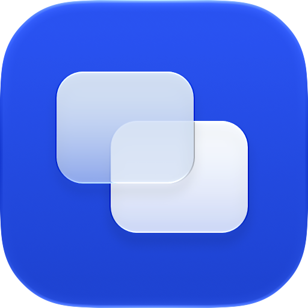

<p align="center"></p>

# Glint

A small native macOS app switcher with Liquid Glass, a hold shortcut, and predictions that learn your switching habits.

Hold **Right Command**, type an app name, then release to open the selected app. Hold and release without typing to choose the learned prediction. Escape cancels. Control–Option–Space opens a regular search palette.

- Searches installed apps, including apps that aren't running.
- Sends a reopen event to recover apps whose last window was closed.
- Learns app pairs, short sequences, time of day, and recent context. Older habits fade with a 14-day half-life.
- Updates the app catalog from filesystem and workspace notifications. No polling timers or network services.
- Stores only timestamps and app identifiers in a local SQLite database. No typed queries, window titles, document paths, or web activity are recorded.

## Build

Requires macOS 26 or later and Xcode 27 with its Swift toolchain and Icon Composer support.

```sh
./build.sh
swift test --build-system native -c release --disable-sandbox
```

The build produces `Glint.app`. Move it to `/Applications` and open it. Enable the hold shortcut in Settings → Keyboard and allow Glint in System Settings → Privacy & Security → Accessibility (called Device Control and Data Access on newer macOS versions). Quit another launcher first if it uses the same physical key.

The build uses an available Apple Development identity to keep local permissions stable between builds; otherwise it signs ad hoc. Set `CODE_SIGN_IDENTITY` to select a specific identity. Local builds are not notarized. macOS may ask for permission again after a signing identity or install path changes.

## Learning

Predictions combine a smoothed app-to-app model with recency and time context. Repeated short-sequence evidence can outweigh recency as confidence grows. Explicit text matches always take priority over predictions.

Settings → Learning can import Applight's local history. Choose its containing folder so SQLite can read its journal. Imports are read-only and skip duplicates. Glint is an independent implementation and contains no Applight code or assets.

Data stays in `~/Library/Application Support/Glint/switches.sqlite`. Startup reads the most recent 100,000 switches; older records remain stored. This repository contains no personal history. To run an optional chronological replay on your own data, provide `GLINT_HISTORY_PATH` pointing to a JSON array of `SwitchEvent` records. The test prints aggregate accuracy and latency locally.

## Design and implementation

AppKit panel and controls, Apple's glass material, Swift concurrency for app scanning, SQLite for local history, and a small dependency-free ranking model. The icon is two minimal SVG panes authored with Claude Opus and finished in Apple Icon Composer; its editable source is in `Assets/Glint.icon`.

Tests cover search tiers, windowless and nonrunning candidates, Unicode names, gesture cancellation, adaptive predictions, read-only import, duplicate imports, persistence, and search performance. Native keyboard interception, OS permissions, and app-specific reopen behavior also require testing on a real Mac.

## License

MIT. See [LICENSE](LICENSE).
